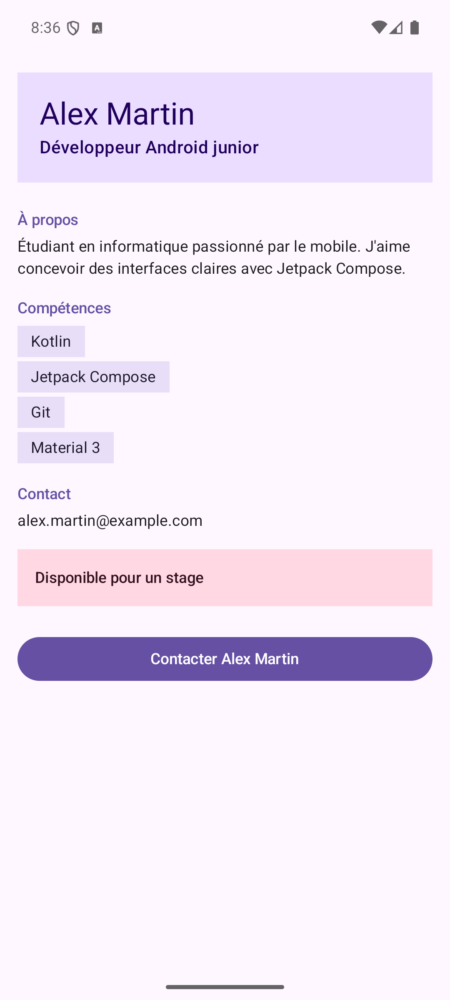

# Profil développeur Compose

## Description

Application Android réalisée avec Jetpack Compose qui affiche la fiche de profil d'un développeur.
L'écran présente le nom, le rôle, une courte description, une liste de compétences, une adresse de contact
et la disponibilité de la personne. Une zone cliquable « Disponible pour un stage » et un bouton
« Contacter » permettent à l'utilisateur d'agir ; les clics sont remontés au parent via des callbacks.

## Capture d'écran

## Notions utilisées

- fonctions composables (`@Composable`) ;
- paramètres de composables ;
- `Modifier` passé en paramètre (`modifier: Modifier = Modifier`) ;
- chaînage de modifiers ;
- padding externe / padding interne ;
- callbacks (`onClick`, `onContactClick`, `onAvailabilityClick`) ;
- `Scaffold` et `innerPadding` ;
- `Surface`, `Column`, `Text`, `Button` ;
- previews (`@Preview`) avec deux jeux de données ;
- accessibilité de base (`Role.Button`, `contentDescription`).

## Explications

**1. Quels composables avez-vous créés ?**
`ProfileScreen`, `ProfileHeader`, `ProfileDescription`, `SectionTitle`, `SkillList`, `SkillItem`,
`InfoLine`, `AvailabilityBadge`, `ContactButton`, ainsi que deux previews
(`ProfileScreenAndroidJuniorPreview` et `ProfileScreenFullStackPreview`).

**2. Quel composable représente l'écran principal ?**
`ProfileScreen`. Il est appelé dans `MainActivity` à l'intérieur d'un `Scaffold`
et assemble tous les autres composants.

**3. Où utilisez-vous un padding externe ?**
Dans `ProfileScreen` : c'est le parent qui passe `Modifier.padding(...)` à chaque enfant
(`ProfileHeader`, `SkillList`, `AvailabilityBadge`, `ContactButton`…) pour les placer dans l'écran.
`MainActivity` applique aussi l'`innerPadding` du `Scaffold`.

**4. Où utilisez-vous un padding interne ?**
À l'intérieur des composants : dans `ProfileHeader` (la `Column` à l'intérieur de la `Surface`
a `padding(20.dp)`), dans `SkillItem` (espace autour du texte dans la pastille)
et dans `AvailabilityBadge` (`padding(16.dp)` sur le texte). Ce padding espace le contenu
par rapport au bord du composant, quel que soit l'endroit où le parent le place.

**5. Quel composant reçoit un callback ?**
`ContactButton` reçoit `onClick` et `AvailabilityBadge` reçoit `onClick`.
`ProfileScreen` reçoit `onContactClick` et `onAvailabilityClick` et les transmet.
Les composants signalent seulement le clic ; la décision est prise dans `MainActivity`
(fonctions vides commentées pour ce devoir).

**6. Quelle information d'accessibilité avez-vous ajoutée ?**
`AvailabilityBadge` est une zone cliquable personnalisée (une `Surface` et non un `Button`).
J'ai ajouté `role = Role.Button` dans `clickable` et une `contentDescription` dans `semantics`
(« Disponible pour un stage. Appuyer pour voir les détails. »), pour qu'un lecteur d'écran annonce un bouton.
`ContactButton` utilise un `Button`, qui est déjà reconnu comme bouton par l'accessibilité.

**7. Pourquoi vos composants peuvent-ils être considérés comme réutilisables ?**
Ils ne contiennent pas de données en dur : le texte, les compétences, la disponibilité et les actions
sont passés en paramètres. Ils acceptent tous un `modifier` pour que le parent décide de leur placement.
Les deux previews le montrent : le même `ProfileScreen` affiche un profil Android junior disponible
et un profil full-stack non disponible avec d'autres compétences.

## Lancer le projet

Ouvrir le dossier dans Android Studio, laisser Gradle se synchroniser puis lancer la configuration `app`.
